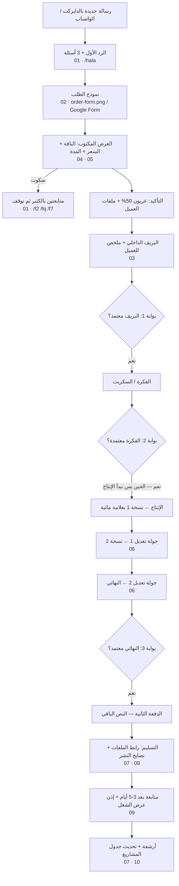

# 07-ops · تشغيل العملاء في طشّ (صفحة وحدة)

نظام بسيط لاستوديو صغير: **الدايركت والواتساب + ملفات جاهزة + جدول واحد.** بدون منصات ولا أنظمة معقدة.
نصنع الإعلان نفسه بس: فيديوهات إعلانية · إعلانات ريلز/تيك توك/ستوري · تصاميم إعلانية · أفكار وسكربتات · موشن جرافيك ومونتاج.
**ما ندير حسابات، ما ننشر، ما ندير حملات ممولة، ما نبيع متابعين، وما نضمن مشاهدات أو مبيعات.**

## المسار من أول رسالة لين التسليم



نفس المسار بالنص:
`رسالة ← /hala ← نموذج ← عرض مكتوب ← عربون 50% + ملفات ← بريف (بوابة 1) ← فكرة/سكربت (بوابة 2) ← إنتاج ← جولتين تعديل ← نهائي (بوابة 3) ← دفعة 50% ← تسليم ← متابعة + إذن عرض ← أرشفة`

## القواعد الذهبية

1. **نرد بنفس اليوم.** رسالة وحدة مرتبة، ولا أرقام مخترعة ولا وعود بنتائج.
2. **كل شي مكتوب:** السعر، الموعد، والاعتمادات (لقطة شاشة في ملف المشروع).
3. **ما نبدأ قبل العربون، وما ننتج قبل اعتماد الفكرة.**
4. **جولتين تعديل** بكل باقة. ملاحظات مجمّعة من شخص واحد. تغيير الفكرة بعد اعتمادها = طلب جديد.
5. **الملفات النهائية بعد الدفعة الثانية.** قبلها معاينة بعلامة مائية.
6. **نستأذن قبل ما نعرض أي شغل عميل.**

## الملفات

| الملف | شنو فيه | منو يستخدمه |
|---|---|---|
| `01-welcome-and-quick-replies.md` | الرد الأول + 12 رد جاهز (سعر، مدة، نماذج، إدارة حسابات، ضمان، دفع، تعديلات، تصوير، متابعة، اعتذار) | للعميل |
| `02-order-form.md` | أسئلة النموذج + إعداد Google Forms | داخلي + للعميل |
| `order-form.html` → `order-form.png` / `order-form.pdf` | النموذج مصمم: صورة 1080×1350 للدايركت، وورقة A4 للطباعة | للعميل |
| `03-creative-brief-template.md` | قالب البريف + ملخص للاعتماد | داخلي |
| `04-pricing.md` | 3 باقات + إضافات + اللي مو مشمول + منطق التسعير بالساعات | داخلي (المرجع للأرقام) |
| `rate-card.html` → `rate-card.png` / `rate-card-story.png` | ورقة الأسعار 1080×1350 و1080×1920 | للعميل |
| `05-process-and-timeline.md` | الخطوات، المدد لكل باقة، العربون، شنو يسلّم العميل، البوابات + رسائل | داخلي + للعميل |
| `06-revisions-and-feedback.md` | تعديل ولا طلب جديد، شلون تنعطى الملاحظات، مدة الجولات + رسائل | داخلي + للعميل |
| `07-deliverables-and-formats.md` | المواصفات، تسمية الملفات، التسليم، الأرشفة، فحص قبل التسليم | داخلي |
| `08-usage-rights.md` | حقوق الاستخدام بلغة بسيطة — **مو استشارة قانونية** | للعميل (بعد مراجعة محامي) |
| `09-delivery-message.md` | رسالة التسليم، نصايح النشر، المتابعة، طلب إذن العرض | للعميل |
| `10-project-tracker.csv` | جدول المشاريع (يفتح في Google Sheets أو Excel) | داخلي |

## الباقات باختصار (أسعار مبدئية قابلة للتعديل)

| | السعر | المدة | التسليم |
|---|---|---|---|
| • **لقطة** — تصميم إعلاني بـ3 مقاسات | 90 د.ك | ثابت | 3-4 أيام عمل |
| •• **ريل** — إعلان سوشال قصير | 190 د.ك | 15-20 ث | 7-9 أيام عمل |
| ••• **إطلاق** — فيديو 30 ث + 15 ث + مقاس + بوستر | 390 د.ك | 30 + 15 ث | 12-15 يوم عمل |

## الـtracker — طريقة التعبئة

- كل مشروع سطر. **احذف سطر المثال** (أول سطر) قبل الاستخدام.
- التواريخ: `YYYY-MM-DD`. الخانة فاضية = لسه ما صار.
- `feedback`: `R1 2026-11-14; R2 2026-11-17` (تاريخ وصول ملاحظات كل جولة).
- `portfolio permission`: `yes` · `yes-after YYYY-MM-DD` · `no`.
- `hours spent`: الساعات الفعلية — **عشان نعاير الأسعار** (انظر `04-pricing.md`). هذا العمود الوحيد اللي زدناه على القائمة الأساسية.
- `notes`: الحالة (`new` · `quoted` · `confirmed` · `in production` · `delivered` · `archived` · `cold`) وأي ملاحظة.

## إعادة تصدير الصور والـPDF

بعد أي تعديل على `order-form.html` أو `rate-card.html` (من داخل مجلد `tash/`):

```bash
node 07-ops/src/render.mjs
```

يطلع: `order-form.png` (1080×1350) · `order-form.pdf` (A4) · `rate-card.png` (1080×1350) · `rate-card-story.png` (1080×1920).
السكربت يشغّل سيرفر محلي صغير على مجلد `tash/` عشان الخطوط من `_system/tokens.css` تشتغل، وينتظر `document.fonts.ready`، ويطبع تحذير إذا شي طلع برا الإطار.
الملفات تفتح بعد مباشرة في المتصفح (`file://`) — الروابط نسبية (`../_system/` و`../02-logo/`).

## قرارات مفتوحة للمالك

1. **الأسعار النهائية** وسعر الساعة (الحالي فرضية 10 د.ك/ساعة — مو من السوق).
2. **طرق الدفع** المتوفرة فعلاً (تحويل بنكي / رابط كي نت / ومض…).
3. **التصوير الميداني:** هل فيه مصوّر شريك؟ (الرد `/shoot` جاهز بالحالتين).
4. **سياسة الإلغاء والعربون** + نص الحقوق — **مراجعة محامي كويتي**.
5. **ملفات المشروع المفتوحة:** نبيعها؟ بكم؟
6. **مدة الأرشفة** (مقترح 12 شهر) وأيام العمل (مقترح الأحد-الخميس).
7. **ملفات الطباعة** للبوسترات: نقدمها؟
8. **عدد المشاريع بنفس الوقت** (مقترح مشروعين بالكثير بالبداية).
9. **عرض افتتاحي** لأول عملاء؟ (لو صار: بتاريخ انتهاء مكتوب).
